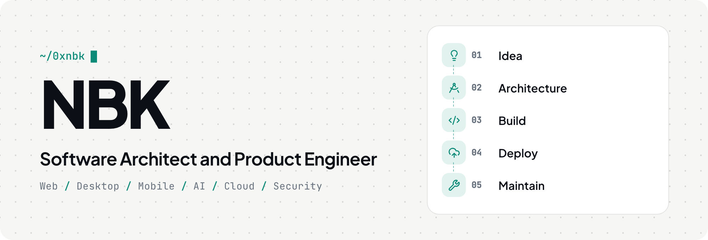

<picture>
  <source media="(prefers-color-scheme: dark)" srcset="assets/banner-dark.png">
  
</picture>

  <a href="https://nbk.dev">nbk.dev</a>&nbsp;&nbsp;·&nbsp;&nbsp;<a href="https://x.com/0xnbk">X</a>&nbsp;&nbsp;·&nbsp;&nbsp;<a href="https://huggingface.co/0xnbk">Hugging Face</a>&nbsp;&nbsp;·&nbsp;&nbsp;<a href="https://pentesterlab.com/profile/0xnbk">PentesterLab</a>&nbsp;&nbsp;·&nbsp;&nbsp;hello [at] nbk [dot] email

### I design and build practical software products for the web, desktop, and mobile platforms.

My work combines product thinking with solid engineering, from shaping an early idea and defining its architecture to building, deploying, and maintaining the finished product.

My primary experience is with Laravel and the TALL stack, but I work comfortably across languages, frameworks, and platforms. I build desktop applications with Tauri, browser extensions, API driven systems, and cloud native applications. I choose technologies based on the needs of the product, with a focus on clarity, reliability, security, and long term maintainability.

Artificial intelligence is part of my everyday engineering workflow. I use it to explore ideas, write and review code, test systems, improve documentation, and evaluate technical tradeoffs. I also build AI features and products, work with model APIs and development tools, fine tune models, and develop practical agent and automation workflows. AI is useful when it is applied thoughtfully, so I pay close attention to correctness, security, performance, and the quality of the user experience.

## What I Do

<picture>
  <source media="(prefers-color-scheme: dark)" srcset="assets/what-dark.png">
  
</picture>

## Core Competencies

<picture>
  <source media="(prefers-color-scheme: dark)" srcset="assets/stack-dark.png">
  
</picture>

## AI and Machine Learning

- **AI products:** Building practical AI features and products
- **Local AI:** Running models on desktop and in the browser with Ollama, llama.cpp, MLX, and ONNX Runtime, so data can stay on the device
- **Model APIs:** Integrating OpenAI, Anthropic Claude, and Google Gemini into web applications, APIs, workflows, and desktop software
- **Retrieval and search:** Building semantic search and RAG with embeddings and vector stores
- **Agents and tools:** Working with developer tools, agents, and automation, and building MCP servers that connect AI assistants to real applications
- **Speech, vision, and translation:** Putting models such as Whisper, CLIP, NLLB, and MADLAD to work in real products
- **Fine tuning:** Developing and fine tuning models with PyTorch, Hugging Face Transformers, PEFT, LoRA, QLoRA, and Unsloth, with experiments shared on [Hugging Face](https://huggingface.co/0xnbk)
- **Evaluation:** Measuring models and tracking experiments with Jupyter, Kaggle, and Weights & Biases
- **Prompts and workflows:** Designing reliable prompts and AI assisted workflows
- **Review:** Checking AI generated code and systems for correctness, security, performance, and maintainability
- **Learning:** Deepening my deep learning practice with fast.ai and PyTorch

## Cloud and Infrastructure

I have extensive experience building and deploying applications on Cloudflare's developer platform. This includes Workers, Pages, D1, R2, KV, Durable Objects, Queues, and the surrounding services used to build fast, globally distributed applications. I also work with AWS, DigitalOcean, and Heroku, selecting the right platform for the product, its operational needs, and its budget.

My infrastructure work includes application deployment, storage and database design, background processing, caching, integrations, observability, CI/CD, and production maintenance. I aim for systems that are straightforward to operate as well as easy to extend.

## Security

Software security is a long standing interest of mine, and it shapes how I design, build, and review systems. I practice web and application penetration testing on [PentesterLab](https://pentesterlab.com/profile/0xnbk), where I have completed more than 350 exercises and earned 15 badges, including Essential, HTTP, Recon, PCAP, Serialize, Android, and Capture the Flag.

## Let's Connect

I enjoy talking about interesting products, software architecture, artificial intelligence, and new ideas. Feel free to reach out or explore my work:

- **Email:** hello [at] nbk [dot] email
- **Twitter/X:** [@0xnbk](https://twitter.com/0xnbk)
- **Hugging Face:** [@0xnbk](https://huggingface.co/0xnbk)
- **PentesterLab:** [0xnbk](https://pentesterlab.com/profile/0xnbk)
